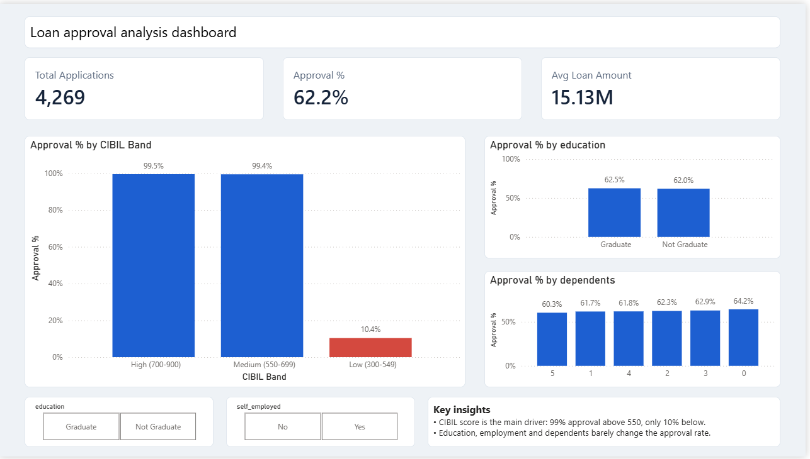

# Loan Approval Analysis

SQL and Power BI analysis of 4,269 loan applications to find what drives loan approval.

## Goal
Find out which applicant factors (CIBIL score, education, employment, income, dependents, assets) affect whether a loan is approved.

## Tools
- MySQL (data cleaning and analysis: joins, CASE, CTE, window functions)
- Power BI (dashboard, DAX measures)
- Excel (initial data check)

## Files
- `loan_analysis.sql`: all 12 SQL queries, each with its question
- `loan_approval_dashboard.pbix`: Power BI dashboard
- `loan_data_clean.csv`: dataset used (Kaggle loan approval dataset)
- `Dashboard.png`: dashboard screenshot

## Key insights
1. Overall approval rate is 62.2% (2,656 approved, 1,613 rejected).
2. CIBIL score is the main driver: applicants with a score of 550 or more were approved about 99% of the time, versus about 10% for scores below 550.
3. Approved applicants have an average CIBIL score of about 703, versus about 429 for rejected ones.
4. Education (62.5% vs 62.0%), employment type and number of dependents barely change the approval rate.
5. Income group and total assets show no clear pattern in approval.

## Data notes
- Text columns had extra spaces, which were removed with TRIM.
- One row (loan_id 10) had a non-numeric value ("x") in residential_assets_value. It was kept with NULL for that value.
